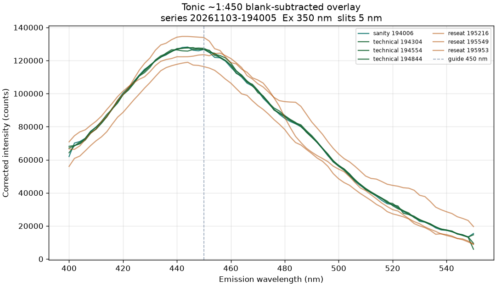
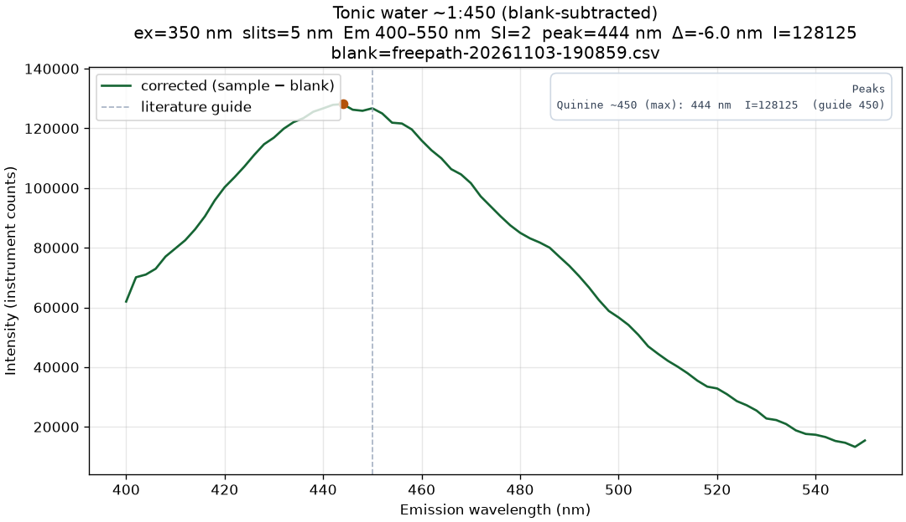

# Tonic-Water Quinine Emission Baseline (DIY Fixture)

November 3, 2026 | Series `20261103-194005` | Quartz cuvette, Ex `350 nm`, Em `400–550 nm`, `5 nm` slits

> **Scope:** DIY square-bore aluminum block (Gate D still open). This is a **go/no-go usefulness check** for quinine fluorescence from commercial tonic — **not** the full Expt 1 dilution / IFE ladder. Procedure: [../experiments/tonic-water.md](../experiments/tonic-water.md).

---

## 1. Verdict

**Go** for continued fluorescence work on this fixture. Quinine emission is clearly detected near the literature guide; intensity is usable once the tonic is dilute enough to avoid ADC clip.

| Check | Result |
| --- | --- |
| Optical path / acquisition | **Yes** — gate series 7/7 `passed`, shutter restored OFF |
| Quinine emission near `450 nm` | **Yes** — blank-subtracted band; gate mean peak **447 ± 5 nm** |
| Wavelength offset (guide `450 nm`) | Gate mean **Δ ≈ −3.0 ± 5.2 nm** (sanity gate \|Δ\| ≤ `15 nm` met) |
| Detector clip / overload | **Clear at ~1:450**; clipped hard at `1:1`, `1:2`, and `~1:90` scout loads |
| Reseat stability | Intensity OK (~119k–135k); peak λ scatter larger on reseat (±7.6 nm) than technical (±3.1 nm) |

Photon path and fluorescence mode are real. Dominant practical limit for quant work remains Gate D seating (plus brand-dependent tonic strength — start dilute).

---

## 2. Setup and conditions

| Item | Detail |
| --- | --- |
| Sample | Degassed commercial tonic drink mixer; gate series at **~1:450** tonic:total (approx; ~5× dilute from a ~1:80–1:100 scout that still clipped) |
| Holder | Unanodized Al square-bore block; loose 12.5 mm cuvette seat (same DIY fixture as water Raman) |
| Blank | Matched distilled water in same cuvette / orientation: `logs/freepath/freepath-20261103-190859.csv` (Em `400–550`, slit `5`) |
| Series | `20261103-194005` — 1 sanity + 3 technical + 3 reseat |
| Scout runs (clipped, same blank) | `1:1` `191706`; `1:2` `192500`; `~1:90` `193416` — archived under `logs/tonic-water/` for dilution context |
| Artifacts | `logs/tonic-water/` (gitignored); summary `logs/tonic-water/20261103-194005-summary.json` |
| Software | `scripts/run_tonic_water_serial.py`, `scripts/summarize_tonic_water.py` |

Locked acquisition: Ex `350 nm`, Em `400–550 nm`, slits `5 nm`, speed `120 nm/min`, step `2 nm`.

---

## 3. Aggregate results

From `summarize_tonic_water.py --series-id 20261103-194005`:

| Set | n | Peak (nm) | Δ from 450 (nm) | Peak intensity |
| --- | ---: | --- | --- | --- |
| Sanity | 1 | 444.0 | −6.0 | ~128k |
| Technical | 3 | 446.7 ± 3.1 | −3.3 ± 3.1 | ~127.5k ± 0.6k |
| Reseat | 3 | 447.3 ± 7.6 | −2.7 ± 7.6 | ~126.0k ± 7.9k |
| **Gate (tech + reseat)** | **6** | **447.0 ± 5.2** | **−3.0 ± 5.2** | **~126.8k ± 5.1k** |

All gate runs: `clipped=false`, max \|I\| ≈ `147k–163k` (well below `999999`).

Scout clip ladder (same blank, not in gate stats): `1:1` and `1:2` saturated ~66/76 points; `~1:90` still clipped ~20/76 points at the band top — enough to force further dilution before the series.

---

## 4. Figures

### Series overlay (sanity + technical + reseat)

Broad blue band centered short of the `450 nm` guide; reseats track the same shape with modest intensity/λ jitter.

### Example sanity annotated plot

---

## 5. Interpretation

1. **Wavelength:** Gate mean ~`447 nm` vs guide `450 nm` is within a few nm — good enough as a DIY fluorescence wavelength sanity check on this fixture (same order of offset as the water-Raman DIY baseline).
2. **Sensitivity / dynamic range:** Quinine in grocery tonic is bright at Ex `350` / `5 nm` slits. Useful unclipped work on this mixer needed ~`1:450`, not the literature-style `1:20`–`1:80` start. Treat dilution as brand- and slit-dependent.
3. **Seating:** Technical intensity is tight (~0.5% RSD); reseat intensity RSD ~6% and peak λ std grows — same mechanical theme as water Raman. Fix Gate D before Expt 1 linearity claims.
4. **Go/no-go:** Proceed with home-lab fluorescence experiments; keep tonic dilute enough to stay off the clip ceiling and document approximate dilution.

---

## 6. Follow-ups

- [ ] Positive, repeatable cuvette seat (Gate D) before full Expt 1 `1:20`–`1:320` ladder / IFE analysis.
- [ ] Optional: record exact volumetric dilution next time; optional scout at `2.5 nm` slits if staying concentrated.
- [ ] Re-check a short tonic series after seating fix; expect tighter reseat peak scatter.
