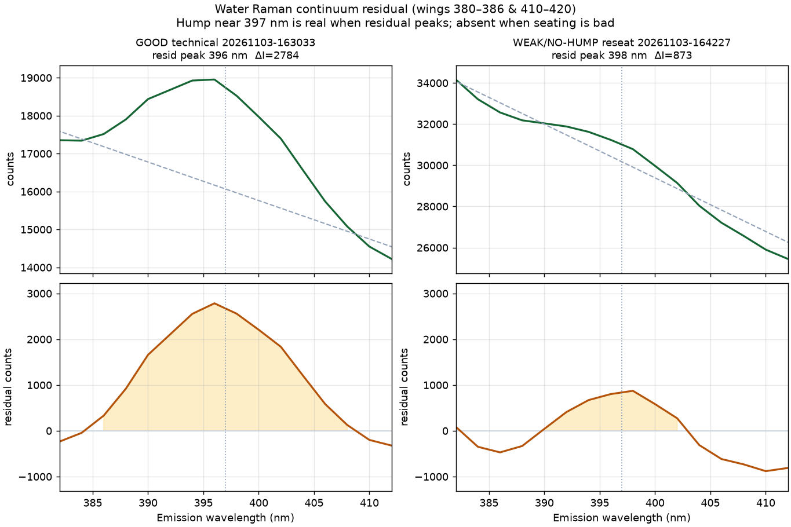
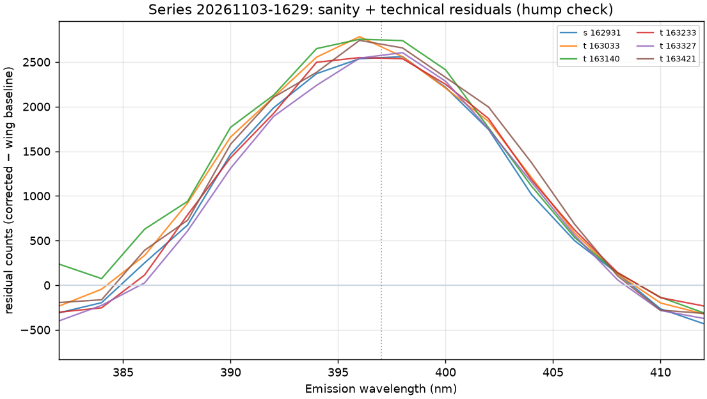
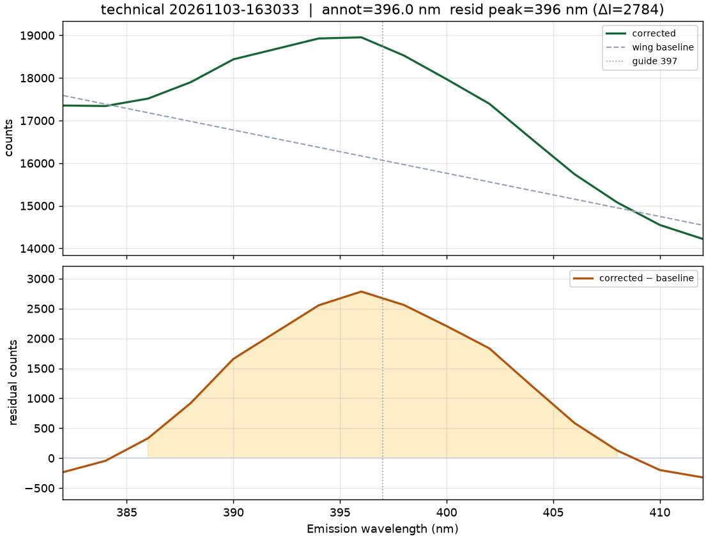

# Distilled Water Raman Baseline (DIY Fixture)

November 3, 2026 | Series `20261103-1629` | Quartz cuvette, Ex `350 nm`, Em `380–420 nm`, `10 nm` slits

> **Scope:** DIY square-bore aluminum block (Gate D still open). This is a **go/no-go optical-path check** and wavelength/SNR baseline for the present fixture — **not** a factory `L2250140` / `500:1` validation. Procedure: [../experiments/water-raman.md](../experiments/water-raman.md).

---

## 1. Verdict

**Go** for continued home-lab investment, conditional on fixing cuvette seating before quantitative work.

| Check | Result |
| --- | --- |
| Optical path alive (dark + Em scan + PMT) | **Yes** — all 11 acquisitions `passed`, no overload |
| Water O–H Raman near `397 nm` | **Yes** — continuum-residual hump peaks ~`396–398 nm` on good seats |
| Wavelength offset (guide `397 nm`) | Technical mean **Δ ≈ −1.8 nm**; calibration (tech+reseat) **Δ ≈ −2.4 ± 2.7 nm** |
| Absolute-peak RMS SNR vs factory `500:1` | Mean **~123** (~**4× below**); DIY fixture expected |
| Reseat stability | **Poor** — intensity ~8k–33k; two reseats nearly lose the hump |

The photon path is real. The dominant limitation is mechanical (loose ~17 mm bore vs 12.5 mm cuvette, unsecured block, no return mirrors), not a dead lamp/mono/detector.

---

## 2. Setup and conditions

| Item | Detail |
| --- | --- |
| Sample | Distilled water in 4-window UV quartz cuvette (condensate-collected water; not sealed-bottle DI) |
| Holder | Unanodized Al square-bore block; black gaffer tape on exterior; cuvette sits loosely |
| Blank | Matched freepath empty compartment, same Ex/slits/speed/step: `logs/freepath/freepath-20261103-162601.csv` |
| Series | `20261103-1629` — 1 sanity + 5 technical + 5 reseated |
| Artifacts | `logs/water-raman/` (gitignored); summary `logs/water-raman/20261103-1629-summary.json` |
| Software | `scripts/run_water_raman_serial.py`, `scripts/summarize_water_raman.py` |

SNR in the runner is `peak_intensity / rms(noise)` on blank-corrected counts with noise in `410–420 nm`. That metric uses absolute peak height and is **flattering** relative to Raman contrast above continuum (~2.5–3k residual counts on a ~14–19k floor).

---

## 3. Aggregate results

From `summarize_water_raman.py --series-id 20261103-1629` (annotated local max near guide `397 nm`):

| Set | n | Peak (nm) | Δ from 397 (nm) | Absolute-peak SNR |
| --- | ---: | --- | --- | --- |
| Sanity | 1 | 394.0 | −3.0 | ~104 |
| Technical | 5 | 395.2 ± 1.1 | −1.8 ± 1.1 | ~117 ± 29 |
| Reseat | 5 | 394.0 ± 3.7 | −3.0 ± 3.7 | ~129 ± 22 |
| **Calibration (tech + reseat)** | **10** | **394.6 ± 2.7** | **−2.4 ± 2.7** | **~123 ± 25** |

Wing-baseline residual peak (linear fit on `380–386` and `410–420` nm) confirms a band near the guide when seating is good:

| Kind | Residual peak | Continuum contrast ΔI |
| --- | ---: | ---: |
| Sanity + technical (6) | ~396–398 nm | **~2550–2780** counts |
| Strong reseats | ~396 nm | **~2600–3350** |
| Weak reseats (`164227`, `164351`) | ~396–398 nm | only **~870–950** |

---

## 4. Figures

Full-window blank-subtracted plots bury the band under a sloping continuum. Continuum residuals make the hump obvious.

### Good seat vs weak reseat

Left: technical `163033` — residual peak **396 nm**, ΔI ≈ **2784**. Right: reseat `164227` — residual still near **398 nm** but ΔI ≈ **873** (~3× weaker); absolute annotator latched to **390 nm** on the falling continuum.

### Sanity + technical residual overlay

Undisturbed seats reproduce a broad residual band peaking just short of the `397 nm` guide.

### Example zoomed technical run

---

## 5. Interpretation

1. **Wavelength:** On stable seats the feature is within a few nm of literature `397 nm` (technical mean ~395 nm). Good enough as a DIY wavelength sanity check; not a closed `±1.0 nm` factory claim.
2. **Sensitivity:** ~4× below published `500:1` is expected without `L2250140` return mirrors, with Al scatter, loose seating, and non-ideal water. Do not use these SNR numbers as instrument health vs brochure.
3. **Seating:** Reseat variance dominates intensity and whether the hump is obvious. Next hardware step: positive cuvette seat (shim/clip/sleeve) and secure the block — keep blacking on Al (do not expose bare metal first).
4. **Go/no-go:** Proceed with the project; treat tonic-water Expt 1 and a short water-Raman redo after seating fixes as the next usefulness gates.

---

## 6. Follow-ups

- [ ] Positive, repeatable cuvette seat in the square bore; bolt the block to the accessory platform (Gate D remaining items).
- [ ] Prefer sealed bottled DI/distilled water; mark cuvette face/orientation.
- [ ] Re-run a short water-Raman series after seating fix; expect tighter peak/SNR scatter.
- [ ] Optional software: continuum-residual plot + contrast SNR `(peak − continuum) / noise` in the water-Raman runner.
- [ ] Factory `500:1` / `±1.0 nm` remain **open** until a qualified holder (or honest DIY sensitivity claim with documented geometry).
