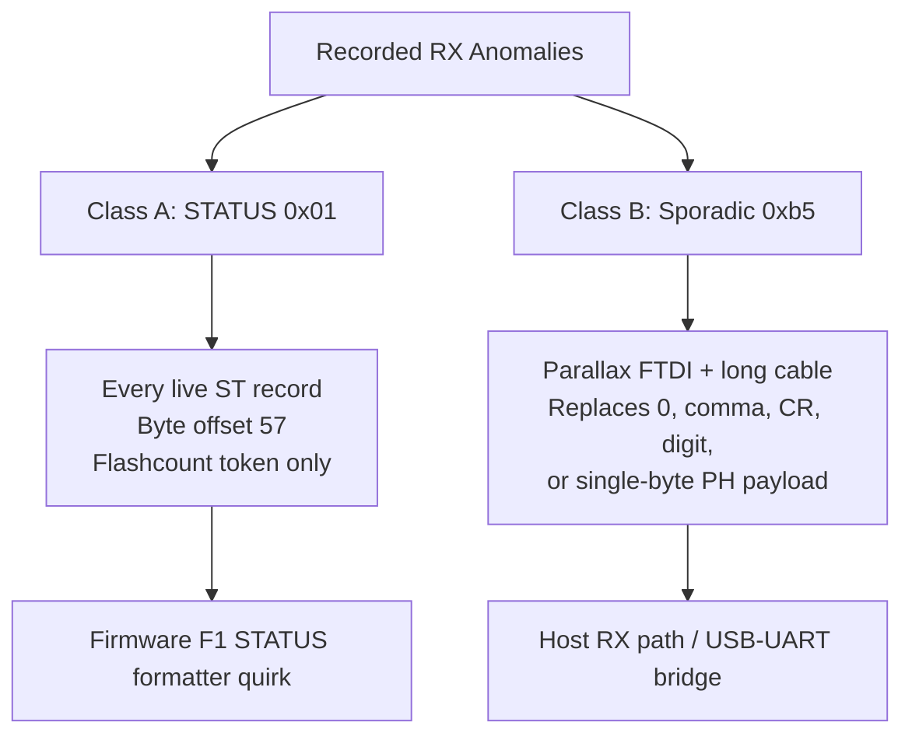

# LS 55 Serial-Link Glitch Taxonomy

October 28, 2026 | Root-cause analysis and host mitigations for this bench LS 55 (firmware `F1`)

This document analyzes the two RS-232 anomaly classes observed during bring-up at **9600 baud, 8N1 (prompted mode)** and maps them to the parser guards in [`ls55/protocol.py`](../../ls55/protocol.py) and [`ls55/transactions.py`](../../ls55/transactions.py). For a broader list of device limitations, see [known-issues-and-limitations.md](known-issues-and-limitations.md).

Refresh corpus statistics at any time with:

```bash
python scripts/analyze_serial_glitches.py
```

---

## 1. Executive Summary and Current State

Recorded serial anomalies separate into two unrelated phenomena:

| Class | Signature | Frequency | Root Cause | Current Status |
| --- | --- | --- | --- | --- |
| **Class A** | `0x01` (SOH) at byte offset 57 of `$ST` STATUS | **100%** of live `$ST` records | Deterministic firmware `F1` flashcount field formatting quirk | Handled in `_parse_int_field`; harmless |
| **Class B** | `0xb5` replacing a single ASCII byte or CR | **0 / 90 txns** on Prolific + short cable (`9.4 / 100` on Parallax FTDI + long cable) | Host RX path framing / USB–UART bridge corruption | Eliminated in hardware by Prolific + short cable; parser guards retained |
| *Normal DUT behavior* | Leading DEL `0x7f`; `55.F1` period separator; `480.019` `speed.response` join | 100% deterministic | Documented RS-232 framing or firmware `F1` formatting | Parsed natively |



### Adapter Comparison (Prolific vs. Parallax FTDI)

Replacing the Parallax `#28030` (FTDI) adapter and long gray cable with a **Prolific USB-Serial Controller** (`/dev/serial/by-id/usb-Prolific_Technology_Inc._USB-Serial_Controller-if00-port0`) and short cable isolated Class B to the host RX hardware path:

| Log Corpus | Transactions | Class A (`0x01` @ offset 57) | Class B JSON Events | Raw `RX hex=b5` Lines | Class B per 100 Txns |
| --- | ---: | ---: | ---: | ---: | ---: |
| **Prolific + short cable** (`logs/identity_prolific`, 5 dumps) | 80 | 5 / 5 `$ST` | **0** | **0** | **0.0** |
| **Prolific + short cable** (`logs/stage1_prolific`, 1 run) | 10 | 1 / 1 `$ST` | **0** | **0** | **0.0** |
| Historical Parallax FTDI (`logs/identity`, 2 dumps) | 32 | 2 / 2 `$ST` | **3** (B2, B4, B5) | **3** | **9.4** |
| Full historical Parallax corpus (all `logs/` prior to Prolific) | 207 (40 files) | 14 / 14 `$ST` | **8** (B1×1, B2×3, B3×1, B4×1, B5×1, B6×1) | **9** | **3.9** |

---

## 2. Class A — Deterministic `0x01` in `$ST` Flashcount

### Manifestation

Every DEL-prefixed `$ST` status record contains a single `0x01` byte at **0-based byte offset 57** (counting the leading `0x7f` DEL byte):

```text
55.F1,0001,365.0,435.0,  480.019,10.0,10.0,  100,   100,\x01 1,   16
                                                  gate  delay  flash  cycle
```

The flashcount CSV field is emitted as the 3-byte sequence `0x01`, `0x20` (space), `0x31` (`'1'`).

### Why It Is a Firmware Quirk, Not Link Noise

Per the User's Guide (`$ST` reference, printed pp. 153–154 / `LS55-Users-Guide.txt` ~4284–4337), `<flashcount>` is a 2-digit space-padded integer (`" 1"`). In live captures:

- **100% occurrence rate** across both adapters and cables (20/20 live `$ST` records).
- **Fixed byte offset (57)** while all surrounding ASCII fields remain uncorrupted.
- **Host handling:** `_parse_int_field` in [`ls55/protocol.py`](../../ls55/protocol.py) extracts the integer `1` while preserving the raw byte string in `status_raw`.

---

## 3. Class B — Sporadic `0xb5` Byte Substitution

### Manifestation Modes (Historical Parallax FTDI Corpus)

On the Parallax FTDI + long cable setup, a single byte `0xb5` (`1011_0101`, MSB set) sporadically replaced an expected ASCII character across six contexts:

| Mode | Observed Bytes (Hex) | Expected ASCII | Example Log |
| --- | --- | --- | --- |
| **B1** — Leading byte on status code | `b5 30 30 30 30 0d 0a` | `0000\r\n` | `logs/stage1/stage1-20261028-152616` |
| **B2** — Corrupted digit in `0000` | `30 30 30 b5 0d 0a` | `0000\r\n` | `identity-212336` (`$ST`); `freepath-204514` (`$ES`) |
| **B3** — Corrupted CR before LF | `30 30 30 30 b5 0a` | `0000\r\n` | `freepath-161608` cleanup (`partial=b'0000\xb5\n'`) |
| **B4** — Corrupted comma in `$AF` | `7f 30 b5 30 2c ...` | `0,0,...` | `identity-212243` (`$AF`) |
| **B5** — Corrupted digit in `$GM` | `7f 33 b5 35 2e 30 ...` | `365.0,...` | `identity-212243` (`$GM`) |
| **B6** — Single-byte payload in `$PH` | `7f b5 0d 0a` | `0` (`$PH`) | `stage1-153747` (`$PH`) |

### Electrical and Framing Assessment

- **Multi-bit delta with MSB set:** Hamming distance from victims (`'0'` = `0x30`, `','` = `0x2c`, `CR` = `0x0d`, `'6'` = `0x36`) is 3–5 bits with bit 7 always high, characteristic of a receiver sampling a stop bit as MSB or USB–UART bridge FIFO corruption.
- **Baud rate verified:** MSO7104B scope measurement on DB25 pin 2 confirmed exact 9600 8N1 bit timing (`~104 µs`), and the instrument never reported `0022` (UART framing/parity/overrun error) during these events.
- **Resolved by adapter/cable swap:** Switching to the Prolific adapter + short cable eliminated all Class B events across 90 consecutive transactions.

---

## 4. Host Mitigation Map

Parser and framing guards remain active in the codebase to protect against transient RX corruption:

| Mitigation | Location | Target Anomaly | Residual Limitation |
| --- | --- | --- | --- |
| `_strip_leading_junk` | [`ls55/protocol.py`](../../ls55/protocol.py) | **B1** (leading `0xb5` before `0000`) | None |
| `_coerce_status_code` | [`ls55/protocol.py`](../../ls55/protocol.py) | **B2** (high byte inside 4-byte code → `'0'`) | Safe only when true code is `0000`; could mask a glitched non-zero error code |
| High-byte + LF → CRLF rewrite | [`ls55/transactions.py`](../../ls55/transactions.py) (`_read_record`) | **B3** (`0xb5\n` replacing `\r\n`) | None |
| `sanitize_af_bits` | [`ls55/protocol.py`](../../ls55/protocol.py) | **B4** (`\ufffd` between `0`/`1` flags → `','`) | Specific to `$AF` bit strings |
| `_parse_int_field` | [`ls55/protocol.py`](../../ls55/protocol.py) | **Class A** (`\x01 1` in `$ST` flashcount) | None |
| Duplicate `0000` wait for data | [`ls55/transactions.py`](../../ls55/transactions.py) (`Transaction.complete`) | **B1** recovery on data-bearing commands | None |

Unit tests covering these cases live in [`tests/test_protocol.py`](../../tests/test_protocol.py).

## Sources

1. PerkinElmer LS 55 User's Guide, release C, March 2007, pp. 125–161 — obtain locally per [../vendor/README.md](../vendor/README.md).
2. Bring-up and adapter test records — [../assessment/bringup-report.md](../assessment/bringup-report.md).
3. Glitch analyzer script — [`scripts/analyze_serial_glitches.py`](../../scripts/analyze_serial_glitches.py).
